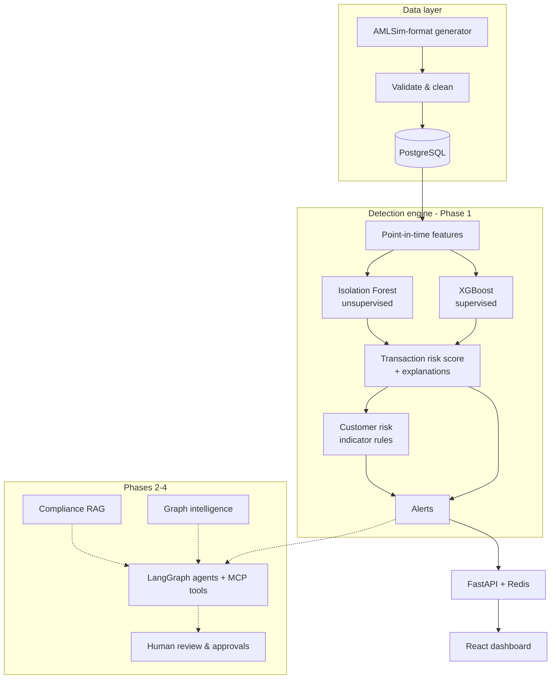

# FinGuard AI

**A hands-on learning project: building an intelligent financial-crime investigation platform, one type of intelligent system at a time.**

FinGuard AI helps (simulated) bank analysts find suspicious money movement, understand customer risk, and - in later phases - investigate cases with graph analytics, compliance RAG and collaborating AI agents. Each phase adds a different family of intelligent system on top of the last, so the repository doubles as a worked example of how they fit together in one production-style application.

> All data is synthetic. Scores, risk bands and alerts are **investigative indicators for human review - never determinations of fraud**.

    

## Intelligent system types covered

| # | System type | What it does in FinGuard | Key techniques | Phase | Status |
|---|---|---|---|---|---|
| 1 | **Predictive ML (supervised)** | Probability that a transaction belongs to a laundering pattern | XGBoost, Random Forest, chronological validation, PR-AUC, top-k recall | 1 | Done |
| 2 | **Anomaly detection (unsupervised)** | Flags behaviour unlike anything seen before, no labels needed | Isolation Forest, percentile calibration | 1 | Done |
| 3 | **Rule-based / expert system** | Encodes analyst knowledge as transparent, configurable rules | Structuring rule, weighted risk indicators in JSON config | 1 | Done |
| 4 | **Explainable AI (XAI)** | Shows *why* each score is what it is | Per-transaction TreeSHAP contributions, indicator-level reasons | 1 | Done |
| 5 | **Real-time decisioning** | Scores a new transaction against live history | Shared point-in-time feature pipeline for batch + online | 1 | Done |
| 6 | **Graph intelligence** | Finds rings, mule networks and money chains | NetworkX centrality, cycles, communities, paths | 2 | Planned |
| 7 | **Knowledge system (RAG)** | Answers AML/KYC policy questions with citations | Chunking, embeddings, Qdrant, hybrid search, reranking, RAGAS | 2 | Planned |
| 8 | **Multi-agent system** | Specialist agents collaborate on an investigation | LangGraph supervisor, shared state, routing, retries | 3 | Planned |
| 9 | **Tool-using AI (MCP)** | Agents act only through approved, permissioned tools | Python MCP SDK, validation, audit | 3 | Planned |
| 10 | **Human-in-the-loop governance** | People approve, reject or escalate - AI never decides alone | Approvals, audit trails, RBAC, observability (Langfuse) | 3-4 | Started (audit log) |

## Architecture



## What I learned building Phase 1

- **Accuracy and ROC-AUC mislead on rare events.** At a 0.25% laundering rate, PR-AUC and recall within an analyst's review budget (top 1%) are the honest metrics.
- **Leakage hides in features and in the data generator.** All behavioural features use only events strictly before each transaction, and the data is split by time. A generator quirk briefly made "payment type" the best predictor (PR-AUC 0.86). It was found from feature importance and removed, which lowered the real result to 0.78.
- **Supervised and unsupervised models do different jobs.** The anomaly model is weak at finding *known* patterns but surfaces *unknown* ones, so it gets a small, thresholded weight in the blended score.
- **Explainability shapes the design.** Exact explanations for all 226k rows took 8 minutes, so they are now exact for flagged rows and approximate for the rest (71 seconds).
- **One feature function for batch and real-time** prevents the training/serving skew common in production ML.

Full write-up: [docs/phase1_report.md](docs/phase1_report.md).

## What Phase 1 contains

| Area | What is built | Where |
|---|---|---|
| Data | AMLSim-format synthetic generator (8 laundering typologies, injected dirty rows) | `backend/data_gen/amlsim_synth.py` |
| Ingestion | Read → validate/clean (rejections with reasons) → categorise → bulk `COPY` into Postgres | `backend/app/services/ingestion.py`, `validation.py` |
| Database | 8 tables in PostgreSQL 16, Redis cache | `backend/app/models.py`, `docs/database_design.md` |
| EDA | Markdown report + charts | `docs/eda_report.md`, `docs/eda/` |
| Features | 28 point-in-time features (velocity, new counterparties, fan-in, pass-through, structuring, geography) | `backend/ml/features.py` |
| Models | XGBoost (active), Random Forest (benchmark), Isolation Forest (anomaly); chronological split; registry with metrics | `backend/ml/train.py`, `models/` |
| Scoring | Batch + near-real-time, with per-transaction explanations (XGBoost contributions) | `backend/ml/scoring.py` |
| Customer risk | Behavioural profiles + configurable, explainable indicator scoring | `backend/app/services/risk_scoring.py`, `backend/config/risk_config.json` |
| Alerts | ML, anomaly, structuring rule, high-risk customer | `backend/app/services/alerting.py` |
| API | FastAPI, 19 endpoints, OpenAPI docs | `backend/app/api/routers/`, `docs/api_documentation.md` |
| Dashboard | React + TypeScript + Tailwind: dashboard, transactions, customers, alerts, models, live scoring | `frontend/src/` |
| Tests | 33 pytest tests (unit + full-pipeline integration + every endpoint) | `backend/tests/` |
| Results | Model evaluation and design decisions | `docs/phase1_report.md` |

## Quick start (Windows / macOS / Linux)

Prerequisites: Docker Desktop, Python 3.12, Node 20+.

```bash
cp .env.example .env
docker compose up -d postgres redis          # Postgres on localhost:55432, Redis on localhost:6380
```

```bash
cd backend
python -m venv .venv
.venv/Scripts/pip install -r requirements.txt     # macOS/Linux: .venv/bin/pip
.venv/Scripts/python -m app.cli all               # init DB, generate, ingest, EDA, train, score, risk, alerts (~5 min)
.venv/Scripts/python -m uvicorn app.main:app --port 8000
```

```bash
cd frontend
npm install
npm run dev                                   # http://localhost:5173  (proxies /api to :8000)
```

- Dashboard: http://localhost:5173
- API docs (Swagger): http://localhost:8000/docs

Ports 5432/5433 are often used by a local Postgres install, so the container is published on **55432**. Change `POSTGRES_HOST_PORT` / `DATABASE_URL` in `.env` if needed.

### Individual pipeline steps

```bash
python -m app.cli init-db --drop
python -m app.cli generate --customers 1500 --days 180
python -m app.cli ingest --source ../data/raw/amlsim     # works with real AMLSim output too
python -m app.cli eda
python -m app.cli train
python -m app.cli score
python -m app.cli risk
python -m app.cli alerts
```

### Run everything in Docker (optional)

```bash
docker compose --profile app up -d --build
docker compose exec backend python -m app.cli all
```

## Testing

```bash
cd backend
.venv/Scripts/python -m pytest -q
```

The test suite generates a small dataset, runs the **whole pipeline** into a throwaway SQLite database and calls every API endpoint - no Docker needed.

## Reviewing Phase 1 - suggested checklist

1. **Data**: `data/raw/amlsim/generation_summary.json`, `data/processed/ingestion_report.json`, `data/processed/rejected_transactions.csv` (every rejected row has a reason).
2. **Tables**: `docker compose exec postgres psql -U finguard -d finguard` then e.g. `\dt`, `SELECT risk_level, COUNT(*) FROM customer_risk GROUP BY 1;`
3. **EDA**: `docs/eda_report.md`.
4. **Models**: `docs/phase1_report.md`, `models/evaluation_*.json`, or the Models page.
5. **API**: http://localhost:8000/docs - try `GET /api/v1/customers?risk_level=HIGH` and `POST /api/v1/transactions/score`.
6. **UI**: open a high-risk customer → indicators, profile, velocity, counterparties, transactions → click a transaction → explanation.
7. **Audit**: `GET /api/v1/audit-logs` shows ingestion, training, scoring and scoring-request events.

## Repository layout

```
backend/   app/ (API, services, models)  ml/ (features, training, scoring, EDA)  data_gen/  config/  tests/
frontend/  React + TypeScript + Tailwind dashboard
data/      raw/ processed/ synthetic/        (generated, git-ignored)
models/    fraud/ anomaly/ evaluation_*.json (generated, git-ignored)
docs/      phase1_report.md  database_design.md  api_documentation.md  eda_report.md
infrastructure/postgres/init.sql
docker-compose.yml  .env.example
```

## Roadmap

- **Phase 2** - Graph intelligence (NetworkX: cycles, communities, centrality) + compliance RAG (Qdrant, citations, RAGAS)
- **Phase 3** - LangGraph multi-agent investigations, MCP server, evidence & case management, approvals
- **Phase 4** - Full frontend, auth/RBAC, Langfuse observability, CI/CD, deployment
