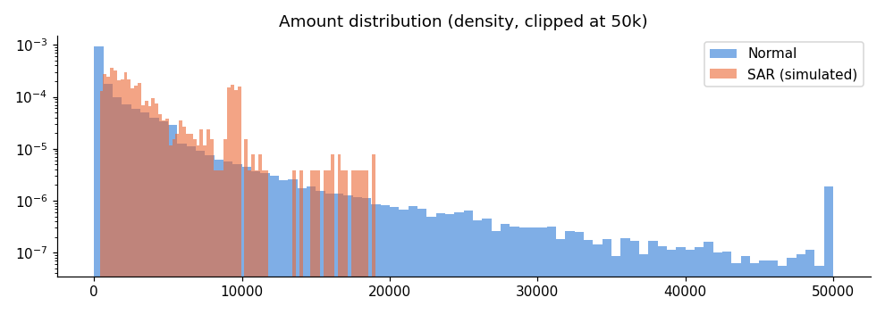
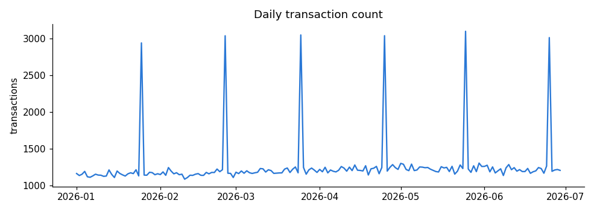
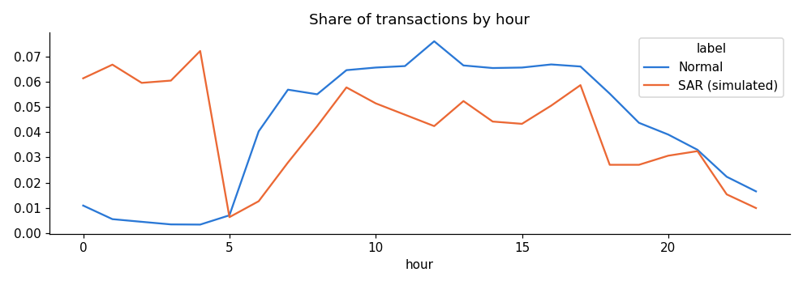

# FinGuard AI - Exploratory Data Analysis

Generated from the ingested PostgreSQL tables (synthetic AMLSim-format data).
SAR labels are simulator ground truth, used only to train and evaluate models.

## Dataset size

| Item | Count |
|---|---|
| Customers | 1,500 |
| Accounts | 2,382 |
| Accounts in simulated laundering patterns | 232 |
| Transactions | 226,345 |
| Simulated SAR transactions | 1,108 (0.49%) |
| Simulated laundering patterns (alerts) | 120 |
| Period | 2026-01-01 to 2026-06-29 |

Class imbalance is severe (~1 in 204), so PR-AUC and precision/recall at a
review budget (top-k) are the meaningful metrics, not accuracy.

## Customer segments

| segment | customers |
|---|---|
| RETAIL | 1,193 |
| SME | 228 |
| CORPORATE | 79 |

## Amounts: normal vs simulated SAR

| label | count | mean | std | min | 50% | 90% | 99% | max |
|---|---|---|---|---|---|---|---|---|
| Normal | 225,237.00 | 1,752.32 | 4,715.26 | 1.00 | 363.38 | 4,505.44 | 18,741.27 | 813,159.27 |
| SAR (simulated) | 1,108.00 | 3,764.62 | 3,458.34 | 382.71 | 2,306.52 | 9,445.77 | 16,114.77 | 19,024.03 |

## By transaction type

| tx_type | transactions | sar_rate | median_amount |
|---|---|---|---|
| PAYMENT | 123,882 | 0.00 | 217.12 |
| TRANSFER | 65,813 | 0.01 | 1,013.71 |
| WIRE | 36,650 | 0.01 | 359.83 |

## By derived category

| category | transactions | sar_rate | median_amount |
|---|---|---|---|
| MERCHANT_PAYMENT | 78,491 | 0.00 | 74.61 |
| BUSINESS_TRANSFER | 71,606 | 0.00 | 1,184.55 |
| SALARY_OR_PAYROLL | 34,490 | 0.00 | 2,981.57 |
| BUSINESS_TO_PERSON | 23,274 | 0.01 | 688.78 |
| P2P_TRANSFER | 18,484 | 0.03 | 76.57 |

## Cross-border

| is_cross_border | transactions | sar_rate |
|---|---|---|
| 0 | 171,105 | 0.00 |
| 1 | 55,240 | 0.01 |

## Time patterns

## Observations that drove feature engineering

1. SAR amounts overlap SME/corporate business payments, so amount alone is weak.
2. SAR activity is over-represented at night (00-05h) - `is_night`, `hour`.
3. Laundering typologies show up as bursts: fan-out (many new counterparties), fan-in (many senders
   to one receiver) and pass-through (money leaves soon after it arrives) - velocity windows,
   `sender_new_counterparties_7d`, `receiver_in_count_7d`, `pass_through_ratio`.
4. Structuring shows repeated amounts just below 10,000 - `near_threshold`.
5. Cross-border transfers to elevated-risk jurisdictions have a higher SAR rate - country risk features.
