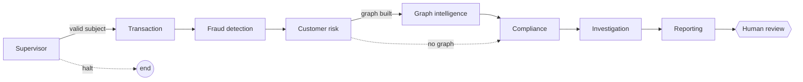

# Phases 3 & 4 Report - Multi-Agent Investigation, MCP, Security & Observability

Run date: 2026-11-16 · all data synthetic · 73 automated tests passing.

Phase 3 turns the detection and knowledge engines into an **investigation platform**: specialised AI agents gather evidence through permissioned tools and write a report that a human decides on. Phase 4 makes it **production-shaped**: login, role-based access, audit, monitoring, CI and deployment.

---

## Part A - The agent workflow

| Agent | Tools it calls | Evidence it produces |
|---|---|---|
| Supervisor | `get_investigation_history` | Request safety check (injection phrasing), case memory (previous investigations), route plan |
| Transaction | `get_transaction_history` | Activity summary; each flagged transaction |
| Fraud detection | `get_fraud_prediction` | ML probability + anomaly percentile + top explanation factors per transaction, model version |
| Customer risk | `get_customer_profile` | KYC profile; each triggered risk indicator with value, threshold, weight |
| Graph intelligence | `get_account_relationships` | Circular flows, layering chains (route, hops, timing), suspicious networks |
| Compliance | `search_compliance_policy` | Policy passages chosen from what the others found (structuring → structuring rules; PEP → EDD rules; …) |
| Investigation | - | Transparent rule-based assessment (score + recommendation, every signal citing evidence) and a narrative |
| Reporting | - | The 10-section report (JSON + Markdown), versioned |

**Design decisions**

- **Agents never touch the database.** They call the same 9-tool registry the MCP server exposes; each call is validated, authorised, timed and audit-logged. A fact in a report → evidence E# → tool call → database row.
- **The assessment is rules, not an LLM.** Score and recommendation come from explicit, cited signals (customer risk level, HIGH-band transactions, peak ML probability, cycles, chains, network risk, structuring, previous escalations). The LLM only *words* the summary.
- **The narrative is checked, not trusted.** The LLM must answer in a JSON schema, cite evidence in every sentence, and avoid stating guilt. Invalid citations are removed, uncited findings dropped; any failure falls back to a deterministic template. The workflow never depends on an LLM being up.
- **Failures degrade, not crash.** Each agent retries transient errors (2 retries, backoff); a permission denial is not retried. A failed agent is recorded and the report lists it as a limitation (tested by breaking the graph tool on purpose).
- **Human-in-the-loop is structural.** The graph ends at `REPORT_READY`. Only an analyst can submit; only an Investigation Manager can decide; never on their own case (four-eyes); a rationale is required; disagreeing with the AI is recorded as an override.

## Part B - MCP server

`python -m mcp_server.server` exposes the 9 tools to any MCP client (Claude Desktop, Claude Code, IDEs). It runs as one service identity with a role, is **read-only by default**, and has **no decide tool**. See [mcp.md](mcp.md).

## Part C - Results

### End-to-end on the full dataset (Postgres, 226k transactions)

Highest-risk customer, request *"Investigate suspicious transactions involving customer CUST11493"*:

| Agent | Duration | Evidence |
|---|---|---|
| Supervisor | 4.9 s (first DB connections) | - |
| Transaction | 0.2 s | E1-E6 |
| Fraud detection | 0.6 s | E7-E11 |
| Customer risk | 0.04 s | E12-E18 |
| Graph intelligence | 0.05 s | E19-E22 |
| Compliance | 105 s first run, 30 s warm (loads embedding + reranker models on CPU) | 3 policy passages |
| Investigation | 3.8 s (template) / 197 s (local `qwen3:4b` narrative on a busy CPU) | E26 |
| Reporting | 0.08 s | report v1 |

Outcome: score **95/100**, recommendation **escalate to MLRO**, 26-27 evidence items, 6 cited signals (customer risk HIGH, 6 HIGH-band transactions, peak probability 1.00, a circular flow, 2 layering chains, a HIGH-risk network).

LLM narrative (local `qwen3:4b`, validated - 0 invalid citations, 0 uncited findings):

> Customer CUST11493 has 78 transactions totaling 75,111.19 from 2026-01-01 to 2026-06-27 [E2]. Indicators suggest high risk with 6 transactions in the HIGH ML risk band [E8][E9][E10][E11][E12][E14] and peak ML suspicion probability of 1.00 [E8]. The account participates in 1 time-ordered circular flow [E20][E21][E22] and is a hop in 2 layering chains [E20][E21][E22]. Customer is a member of a HIGH-risk suspicious network [E23].

Honest note: the validator guarantees citations point at *real* evidence, not that each is the most precise one - E14 above is a risk indicator, not an ML transaction.

### Agent workflow evaluation (`app.cli agent-eval --n 12`, template narratives)

| Metric | Result |
|---|---|
| Cases completed | 12 / 12 |
| Cases with a failed agent step | 0 |
| Evidence items per case | 17.3 |
| Key findings fully cited | 100% |
| "Needs attention" vs simulator ground truth | precision 1.00, recall 1.00 (6 TP, 6 TN) |
| Median time per case (warm) | 5.6 s |

**Read this carefully:** 12 random customers from a synthetic world are mostly *clear-cut* - laundering customers carry strong ML, graph and indicator signals, normal customers carry almost none. 12/12 shows the workflow is wired correctly and consistent with the upstream engines; it is **not** evidence of real-world accuracy. A harder test would sample borderline (MEDIUM-risk) customers.

### What went wrong and was fixed while building

| Problem found | Cause | Fix |
|---|---|---|
| Narratives always fell back to the template | On Windows `localhost` resolves to IPv6 first; Ollama listens on IPv4, so the 1.5 s health check timed out | Default `OLLAMA_URL=http://127.0.0.1:11434`, 5 s probe with one retry, success cached 10 min |
| LLM narrative timed out at 120 s | 27 evidence lines + 450 output tokens at ~4.5 tok/s on a shared CPU | Leaner prompt (25 lines, 160 chars), 350-token cap, dedicated 240 s narrative timeout - and the template fallback kept every case working meanwhile |
| Evaluation summary lost its case count | The key `cases` was used for both the count and the list | Renamed to `case_count` (caught by a test) |
| A Compose file with required secrets broke `docker compose up postgres` on an old `.env` | Compose interpolates every service | Safe local defaults + a startup warning when `JWT_SECRET` is the dev default |

## Part D - Phase 4: security, observability, deployment

- **Security & governance:** see [security.md](security.md) - JWT login, 6 roles / 11 permissions, four-eyes, PII masking, full audit (logins, profile views, every tool call, decisions, overrides), prompt-injection safeguards, MCP controls.
- **Observability:** Prometheus metrics at `/metrics` (HTTP, tool calls, agent steps, investigations, LLM requests/latency); Prometheus + Grafana with a provisioned dashboard (`docker compose --profile monitoring up -d`); optional Langfuse traces (one per investigation, a span per agent, a generation per LLM call); an in-app *Audit & governance* page (agent success rates, override rate, model/graph/RAG/agent evaluations). Note: agent metrics appear in the API's `/metrics` only for investigations started through the API (CLI runs are separate processes).
- **Frontend:** login, role-filtered navigation, investigations list + workspace (live agent timeline, evidence with clickable E# chips, report download, submit/decide), audit & governance, user & role management; customer pages start investigations.
- **CI/CD:** GitHub Actions runs the 73 offline tests, builds the frontend, and builds both Docker images on every push. Deployment outline in [RUNBOOK.md](RUNBOOK.md#9-deploying-to-a-cloud-vm-outline).

## Known limitations

- Assessment thresholds are hand-set; a learned case-prioritisation model needs labelled human decisions (which the approval workflow now collects).
- Bearer tokens in `sessionStorage`, no login throttling, `/metrics` unauthenticated - fine for a local demo, not for production (see security.md).
- The agent evaluation sample is small and easy; the RAG answer evaluation used a small local model.
- No real cloud deployment was performed - the repo is deployment-ready (images, Compose, CI) but choosing and paying for a cloud is left to the owner.
